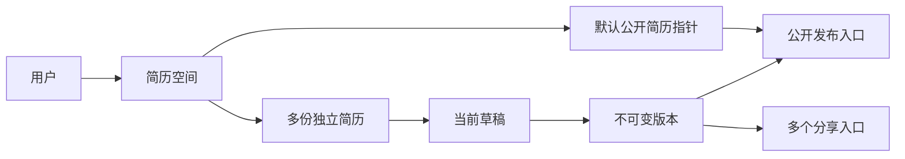

# 简历系统核心设计：多份简历、编排、版本与分享

创建日期：2026-10-12。关联任务：[DAO-027](../../dao/tasks/DAO-027-简历系统核心设计.md)。

本文是简历业务的总设计入口，记录讨论结论与后续展开方向；不是已经实现的功能说明，也不是数据库定稿。Owner 已确认部分产品方向；字段、权限、交互和表结构按用例继续讨论，确认程序化伪代码后才进入开发。

## 1. 目标、边界与文档职责

目标：一个用户管理多份简历，每份拥有独立内容与编排；复用已有展示组件，支持模块新增、编辑、显隐和排序；用发布版本承载公开展示与定向分享，用对比帮助检查差异。

本轮只记录文档，不改源码、共享类型、Prisma schema、迁移、依赖、环境变量或部署配置，不执行接口、数据库或项目质量检查。JSONB、图表库、URL、表名和接口名都是候选，不能据此直接实装。

文档之间的职责：

- 本文：概念、产品方向、跨端关系、决策状态、模块设计入口。
- 后续专题文档：字段、交互、权限、请求/响应、程序化伪代码与人工验收。
- `dao/tasks/`：当前用例的目标、范围、状态、验证与交接事实。
- GitHub Issue：确认方案后的实现范围与验收入口；源码实装前登记。

风险主要在多份内容的同步关系、发布与草稿混用、受限内容泄露、跨端编辑冲突、自由编排的复杂度，以及把尚未确认的表结构当成既定事实。

总体验收：现有字段能够完整承接；多份简历互不误改；模块与条目排序稳定；发布、分享和草稿关系可解释；桌面与移动端阅读顺序明确；权限与分享限制由服务端执行。

## 2. 已确认方向与待确认建议

以下依据 Owner 对本轮讨论的反馈整理。尚未回答的独立问题保持待确认。

| 事项 | 当前结论 | 状态 |
| --- | --- | --- |
| 多份简历与发布版本 | 一次分享对应一份简历的明确发布版本；草稿、简历、版本分开 | 已采用方向 |
| 模块身份 | 固定类型键 + 独立模块实例 ID，同类型允许多个实例 | 已采用 |
| 项目模块 | 公司项目与开源项目共用 `projects` 类型，各自可有标题与项目数组 | 已采用 |
| 个人能力 | 前端、全栈、AI Agent 能力归在个人能力大模块，支持文字与图表 | 已采用方向；键名与字段待定 |
| 数组与列表 | 所有需要列表展示的内容支持新增和排序，模块本身也可排序 | 已采用 |
| Info 与账号 | 简历信息独立于账号资料，Info 可包含联系方式、所在地、学历摘要等 | 已采用 |
| 兴趣图集 | 后续补齐嵌套图片编辑与完整交互 | 已采用方向 |
| 页尾 | 独立于自我评价模块的显隐 | 已采用 |
| 日期 | 结构化年月与自定义文案两种模式，由用户选择 | 已采用 |
| 展示配置 | 保留已有配置，补模块级覆盖与移动端阅读顺序 | 已采用方向；覆盖字段待定 |
| 简历切换条 | admin 使用 SortableBar 管理多份简历，不把各种标记塞进一个 status | 已采用 |
| 编辑入口 | admin 管理中心 + web 当前简历快捷编辑 | 推荐，待确认 |
| 自动保存 | 生产环境考虑 2000～3000ms，替代当前本地 600ms | Owner 提议；确切时长与兜底待定 |
| 默认展示 | 每个用户一个默认公开简历入口 | 已采用；允许空入口及语言规则待定 |
| 分享 | 固定版本、可选密码、有效期、撤销；域名与路径继续讨论 | 已采用方向；接线未定 |
| 对比 | 从简单字段展示升级到差异对齐，可结合 AI 辅助分析 | 已采用方向；AI 范围待定 |
| 自由模块 | 领域模块 + 有边界的通用内容块组合 | 已采用方向；嵌套层级待定 |
| 整体读取 | 区分列表摘要、当前完整简历、批量对比和公开/分享响应 | 已采用方向 |
| 内容共享关系 | 复制后独立编辑，按需复制模块 | 推荐，待确认；不默认启用共享素材引用 |
| 创建与编辑资格 | 所有权按用户建模；哪些角色可创建、代编哪些简历 | 待确认，不能推导为所有用户开放创建 |
| 存储与表结构 | 关系元数据 + JSONB 完整文档，六表候选 | 保留讨论，尚未定稿 |
| 创建最小输入 | 允许稀疏输入（只给姓名/年限/一段经历），由服务端补全为完整文档；`document` 仍必传、`schemaVersion` 由服务端注入 | 已采用方向；[专题 07](./07_简历系统_最小创建输入与默认补全.md) 设计已确认，实现待开工 |

## 3. 当前实现与参考入口

源码中的风格枚举为 `minimal / standard / pro`，本轮提到的 sample 与 minimal 的命名对应仍需确认；不新增第四档。

| 入口 | 用途与当前边界 |
| --- | --- |
| [resume.ts](../../apps/web/layers/11-public-resume/app/types/resume.ts) | 内容、布局、主题、背景、风格类型；模块键目前固定 |
| [useResumeContent](../../apps/web/layers/11-public-resume/app/composables/useResumeContent.ts) | 一份内容的状态与本地自动保存 |
| [useResumeDisplay](../../apps/web/layers/11-public-resume/app/composables/useResumeDisplay.ts) | 显隐、排序、跨栏、主题与风格动作；本地保存 |
| [useHero](../../apps/web/layers/11-public-resume/app/composables/useHero.ts) | 三档个人信息展示共用的数据视图 |
| [模块注册表](../../apps/web/layers/11-public-resume/app/config/resume-sections.ts) | 固定模块类型、标题、默认栏位和组件 |
| [编辑 schema](../../apps/web/layers/11-public-resume/app/config/resume-editor-schemas.ts) | 字段/数组表单；兴趣图片数组尚无完整编辑入口 |
| [正文容器](../../apps/web/layers/11-public-resume/app/components/resume/ResumePageContainer.vue) | 跨栏拖拽、托盘、模块排序；现有移动端按 side/main/rail 堆叠 |
| [SortableBar 示例](../../apps/admin/layers/20-comps/app/pages/comps/sortable-bar.vue) | 多对象切换与横向排序；真实组件为 admin 的 SortableBar |
| [compare-modal 示例](../../apps/admin/layers/20-comps/app/pages/demos/compare-modal.vue) | 桌面多列与移动双份选择；尚未实现真实文档差异对齐 |
| [Prisma schema](../../apps/server/prisma/schema.prisma) | 本仓当前只定义用户与 RBAC，没有简历表 |

当前内容与展示配置分开写入 localStorage，防抖均为 600ms；不是本方案的服务端保存。状态键与存储键也尚未按简历 ID 隔离。`profile.radar` 有类型与编辑字段，但当前组件未实际渲染；`hero.linkUrl` 只存不跳。现有 demo 对比中的薪资、到岗时间等不等于 web 已有字段，不为匹配 demo 直接加入业务模型。

历史说明见 [简历展示架构](../web/06_简历展示_架构设计.md)、[三档风格](../web/07_简历风格_三档实现.md)、[编辑交互](../web/08_简历编辑_交互约定.md)。本文记录后续方向，不把历史实现说明改写为已完成的新功能。

## 4. 简历、草稿、版本、发布与分享

| 概念 | 身份 | 可否持续修改 |
| --- | --- | --- |
| 简历空间 | 用户的简历集合、管理排序与默认公开入口 | 可以 |
| 简历 Resume | 通用版、A 公司版、英文版等独立作品 | 元信息可以修改 |
| 草稿 Draft | 当前编辑中的完整内容与编排 | 自动保存 |
| 版本 Revision | 某时刻冻结的完整内容与编排，例如 A 公司版 v3 | 创建后不修改 |
| 发布 Publication | 公开入口到某个版本的指向 | 可主动换版本或停用 |
| 分享 Share | 独立访问规则与明确版本的指向 | 可主动换版本、改规则或撤销 |

“A 公司版”和“B 公司版”是两份简历；“A 公司版 v1/v2”是同一份简历的历史版本。早期蓝图的多份 draft 在此拆开语义；语言归属于一份简历，不恢复字段级 `{zh,en}` 包裹。

推荐复制整份文档后独立编辑，之后允许按需复制模块；共享素材库、引用与局部覆盖单独讨论。复制默认不继承默认展示资格、公开入口、分享链接与历史版本。

公开发布和分享读取冻结版本，自动保存只改草稿。创建分享时如选当前草稿，先确认并冻结一个版本，再创建分享；不能直接指向随输入变化的草稿。一个版本可以被多个分享引用，同一简历不同版本也可以分别分享。

版本创建时机推荐为主动保存版本、发布或分享，不为每次自动保存创建历史行。回退历史版本应复制其文档到当前草稿，仍保留原有历史；公开入口和分享不自动随回退改变。版本保留数量和清理政策另议，被入口引用的版本不能直接删除。

## 5. 内容与编排：逻辑分离，原子保存

内容回答“有哪些数据”；编排回答“哪些模块出现、在哪一栏、按什么顺序、如何呈现”。独立配置是逻辑分离，不必立即设计关系表。

推荐文档形状（概念说明，不是最终 DTO）：

| 部分 | 内容 |
| --- | --- |
| `schemaVersion` | 文档结构版本，用于校验和兼容升级 |
| `content.sections[]` | 模块实例，每项含 `id/type/title/description/icon/data` |
| `content.footer` | 独立页尾内容，承接 footerNote |
| `display` | 品牌、布局、模块编排、全局开关、主题、背景和风格 |
| `display.sections.order` | 模块 ID 的全局阅读顺序 |
| `display.sections.slot` | 模块 ID 到 side/main/rail 的归属 |
| `display.sections.hidden` | 隐藏模块的 ID；隐藏保留草稿内容 |
| `display.sections.overrides` | 按模块 ID 的显示覆盖，字段白名单待定 |

内容数组的存储顺序不再承担模块阅读顺序；模块顺序只有 `display.sections.order` 一个权威。模块内部的条目数组顺序则直接表达条目顺序，不另存一份相同的排序映射。

模块类型固定用于路由校验、表单与展示组件；实例 ID 表示具体模块。两个 `projects` 可以分别叫“近期公司项目”“AI Agent 开源项目”，也可以只建一个模块混排项目。无需新增一个只因项目来源不同的类型。

Owner 的投递例子：近期公司项目靠前，主要 AI Agent 开源项目随后，早期相关性低的公司项目可后移、隐藏或从定制稿移除。两级排序都必须支持：模块之间、模块内项目之间。

推荐基本信息模块单例，其余领域/通用模块可多实例；单例规则待确认。渲染器和编辑器按实例 ID 操作，不依赖标题或项目名称定位。

如采用 JSONB，可把内容与编排放在同一文档的两部分并原子保存。如以后出现模块级协作、跨简历素材引用或独立查询需求，再评估模块表与布局关系表。本轮不定存储形式。

## 6. 现有字段承接与条目身份

既有字段都应找到落点，名称调整必须提供映射，不能因当前未展示就丢弃。

| 范围 | 需要承接的字段 | 后续补充 |
| --- | --- | --- |
| 基本信息 | name、headline、summary、avatarText、availability | 与登录账号资料独立 |
| 主视觉 | frontImageUrl、backImageUrl、linkUrl、slogans | 未启用链接行为单独确认 |
| Info | 当前 contact 的 key、label、value、icon | 推荐 infoItems；稳定 id + kind，支持自定义条目 |
| 个人链接 | label、url、icon | 稳定 id、排序 |
| 兴趣 | label、icon、description、images | 稳定 id、兴趣与图片两级排序 |
| 兴趣图片 | url、href、title | 稳定 id、alt、图片编辑 |
| 数字块 | label、value、hint | 稳定 id，value 保留展示文案 |
| 形象画廊 | url、alt | 稳定 id、排序与编辑 |
| 能力维度 | 原 profile.radar 的 label、value | 推荐迁至个人能力模块，评分语义另定 |
| 核心竞争力 | title、description | 稳定 id、列表排序 |
| 教育 | school、period、degree、major | 稳定 id、日期模式 |
| 工作经历 | company、period、role、domain、overview、achievements、tech | 稳定 id、经历与成果/标签排序 |
| 项目 | name、period、role、overview、features、highlights、tech | 稳定 id、项目与各列表排序；来源标签可选待议 |
| 技能 | group、items | 承接到个人能力的分组/条目，见下一节 |
| 自我评价 | evaluations | 推荐带稳定 id 的文本条目 |
| 页尾 | footerNote | 独立于自我评价显隐 |

Info 可以放学历摘要；用户不需要完整教育模块时，可以隐藏该模块。学历摘要不默认从教育经历实时派生，是否联动需显式选择，以免定制稿被意外更新。简历邮箱、电话不从 User 自动同步，也不反向修改登录账号。

所有数组或列表展示均提供增加、删除、排序能力：模块、经历、项目、能力组/条目、链接、兴趣/图片、画廊、数字块、标语、成果、技术标签、自我评价等。移动端与键盘提供上移/下移或等效入口；不能只能拖拽。

推荐需要编辑与对比的条目都有文档内稳定 ID；原 string[] 可逐步升级为 `{id,text}` 等有身份的条目，公开渲染视图仍可派生字符串。迁移时不能仅按文本去重，重复文案也可能是独立条目。

ID 在单份文档内唯一。复制整份简历可保留文档内 ID，便于衍生稿对比，但两份简历数据不建立实时关联；同文档内复制模块/条目应生成新 ID。从另一份简历复制模块要处理 ID 冲突，对齐依据与来源记录另行设计。

### 日期模式

- 结构化：开始年月、结束年月、是否至今；年月不以带时区的午夜时间表示。
- 自定义：保留 period 一类展示文案，例如“2023 年暑期”。
- 用户明确选择模式，渲染只读取所选模式。切换可保留非当前模式草稿值，但不能同时把两份内容当成生效日期。
- 校验结构化开始不晚于结束，“至今”与结束年月互斥；不擅自解析自定义文案来计算年限。
- 旧 period 先作为自定义模式导入，不自动推断日期。总工作年限与数字块不直接对经历跨度求和，避免重叠经历重复计算。

## 7. 个人能力：名称、数据与图表

用户可见名称采用“个人能力”，内部键尚待讨论。推荐 `capabilities` 表达大模块，`skills` 表达其中的具体技能条目；若选择继续保留 `skills` 作为模块键，也可以扩展内容结构，不为命名强制迁移。

真实样本和最新讨论见 [个人能力专题 §8～§11](./04_简历系统_个人能力字段与内容结构.md#8-owner-真实样本专业技能)：Owner 提供六组、三十条内容，明确需要自定义分组与评分图表，支持技术之外的岗位；推荐稳定 ID 的对象数组与独立评分维度。整体简历字段先形成概要骨架，最小存储和契约审定后再实现；固定键、量尺、接口与表结构仍非定稿。

推荐分工：

| 概念 | 数据建议 | 呈现 |
| --- | --- | --- |
| 能力分组 | id、title、description，如前端/全栈/AI Agent | 分组标题与说明 |
| 技能条目 | id、name、description，可选熟练程度与证据链接 | 文字、标签、列表 |
| 能力维度 | id、label、可选 score、说明 | 雷达或条状图 |
| 图表配置 | 展示类型、所选维度 ID、排序、统一量尺 | 放展示配置，内容不存 ECharts option |

图表是同一份能力数据的不同视图，不为雷达和条状图维护两套评分。文字技能不自动转换成分数；没有评分时显示文字或空状态，不默认为 0。0～100 量尺可沿用现有 radar，但应明确是自评及评分依据，避免把图表解释为客观测评。

“Vue、TypeScript”等技能与“工程化、系统设计、Agent 编排”等能力维度不必一一对应。技能数量、年限也不直接代表分值。对比不同量尺或不同定义的分数时，应标明不可直接比较。

现有 group/items 与 profile.radar 均需迁移映射；先明确数据，再确认图表渲染方案。ECharts 是 Owner 提出的可选能力，当前不安装、不认定为必选依赖。图表必须提供可读文字/数值视图，移动端和减少动效设置下仍可使用。

## 8. 布局、显隐、覆盖与移动端

保留全局品牌、single/split/threeColumn、side/main/rail、固定栏方向与宽度档位、sticky、主题 light/dark 双 palette、背景 plain/texture/image、图片 fit/overlay/blur，以及三档风格。

模块默认继承全局配置。覆盖可先考虑标题/说明显隐、列表/卡片等支持的呈现形式、技术栈与成果开关；具体覆盖字段和继承优先级由专题确定。切风格不删除内容，某档暂不展示的字段仍保留；编辑器应提示“当前风格不展示”。

移动端采用全局模块阅读顺序；桌面按同一顺序在各栏内排列。切布局不丢栏位和顺序；以后如确有需求，再设计独立移动顺序。现有按栏位堆叠的实现需要显式调整，不能当成已经支持。

隐藏模块保留草稿数据与顺序，放进托盘；删除模块移除内容和所有编排引用，提供撤销或明确确认。编辑态有效空栏保留落点，公开态允许空栏自然收起。

访客临时切换主题等偏好应与作者保存的展示配置分开。访客设置不能保存到作者草稿，也不能使服务端已经过滤的隐藏电话重新出现。

作者选择不向访客展示的模块/字段，在公开和分享响应中按规则过滤，而不是只让组件隐藏；隐藏内容也不能出现在 SSR 数据、页面源代码、SEO 元信息或 AI 检索上下文中。过滤后的文档同步清理编排引用。受限图片需要配套资源访问设计，不能假设保护正文就保护了永久公开图片 URL。

## 9. 编辑入口、简历切换与保存

### 9.1 推荐双入口共用一个编辑模型（待确认）

| 入口 | 推荐职责 |
| --- | --- |
| admin | 多份简历切换/排序、创建复制、完整编排、历史版本、对比、默认展示、发布与分享管理 |
| web | 当前简历的所见即所得快捷编辑，保留卡片编辑 Icon/弹窗；提供回 admin 管理入口 |
| 两端共用 | 文档 Schema、渲染器、字段编辑能力、保存规则、权限和冲突处理 |

web 从公开版本进入编辑时，明确切到该简历的当前草稿，并提示“正在编辑草稿，公开内容仍为 vN”。它不直接覆盖访客看到的版本。分享访客入口默认只读，不因看得到编辑 Icon 就获得权限。

两端不维护独立内容，也不分别写全局 localStorage 单槽位。缓存与临时备份按账号、简历 ID、文档版本隔离；保存响应回写对应简历，旧请求不能覆盖新选中简历。

admin 不能因为有编辑角色就修改任意用户简历；所有权、代编范围、发布/分享权限仍需单独确认。当前“user 阅读、admin 体验编辑”的角色约定不在本文自动升级为全用户简历平台。

### 9.2 SortableBar 管多份简历

顶部 tab 展示内部名称、语言、是否已发布、是否有未发布修改、是否默认展示。选中状态表示当前编辑哪份，不是持久化的简历业务状态。归档、发布、保存失败和分享过期分别表达。

tab 菜单提供重命名、复制、归档/删除；创建入口提供空白模板或复制现有简历。管理排序与公开列表排序分开，拖动公司定制稿不隐式改变默认公开入口。

切换简历、打开对比、发布或创建分享前，确认草稿已保存。失败时保留本地内容，提供重试、继续停留或明确放弃；发布和分享不能悄悄采用上一份保存成功的数据。

### 9.3 生产自动保存候选

Owner 建议改为 2000～3000ms，具体值待专题确认；本轮不改变源码中的 600ms。

推荐：输入立即更新预览，停止编辑后防抖保存；内容与编排作为同一文档原子写入。保存状态至少区分待保存、保存中、已保存、失败、冲突。只有服务端确认才显示已保存。

持续输入时考虑最大等待窗口，避免防抖一直不触发；确切窗口待定。切换简历/离开编辑器有显式 flush，发布前等待成功。页面关闭时不能依赖一定完成的异步请求，可保存按身份隔离的恢复副本并提示风险，不声称浏览器兜底保证成功。

保存带 expectedRevision，服务端条件更新成功才递增 revision；旧窗口返回 409，提供重新载入、差异对比或另存为简历，不静默覆盖。同一简历的保存请求串行或等效协调，保留请求期间新产生的修改，不能把它们误标为已保存。失败重试和离线恢复不能越过并发检查。

## 10. 默认公开入口与分享地址

Owner 提出的地址可行：

- 默认公开入口：`https://resume.fridolph.top`。
- 分享入口：`https://share-resume.fridolph.top/A_xxxxxx`、`https://share-resume.fridolph.top/B_xxxxxx`。

每个路径标识一次分享，不是简历版本的编码。后台关系可以是：

| 地址中的分享标识 | 简历 | 固定版本 | 规则 |
| --- | --- | --- | --- |
| A_xxxxxx | A 公司版 | v3 | 密码、到期时间 A |
| B_xxxxxx | B 公司版 | v2 | 链接访问、到期时间 B |
| C_xxxxxx | A 公司版 | v4 | 独立分享，保留 A 链接的 v3 |

A/B 可以是可读前缀，但不能承担鉴权或依靠短编号提供不可猜测性；推荐高熵随机标识，后台另存“发给哪家公司”的内部标签。不在路径暴露公司名、邮箱或数据库主键。公开显示 v3 仅是说明，访问仍由分享映射决定，不能改 URL 的版本号就拿到另一版。

一个简历可以有多个分享，同一版本也可以分别给多家公司建立独立链接。推荐默认固定版本；主动更新既有链接到新版本时先展示差异，并明确告知旧地址随后会读到新版本。若要保留两份发送记录，创建新分享。

同域路径 `https://resume.fridolph.top/s/<随机标识>` 也能实现同样功能，路由与部署更少；独立分享子域便于区分入口，但增加 DNS、TLS、部署路由与跨域接线。两种都不天然更安全，最终域名待确认。本轮不改 DNS、环境变量、CORS、Cookie 或发布脚本。

根域名如何选中“我的默认简历”需要一条站点归属规则：个人站可以映射到 Owner 的公开空间；以后多用户可使用 `/u/<publicHandle>` 或类似路径。不能默认按当前登录者确定公开主页，否则访客无法获得稳定结果；具体站点归属和路由另议。

每用户一个默认公开简历指针。推荐只指向本人未删除且公开启用的简历；用户暂未发布时允许无默认入口并显示明确空状态。语言切换若要选择另一份独立简历，需要显式公开关联/映射，不自动公开其他定制稿。

公开可访问与列入公开列表分开。不列入列表的公开地址仍可访问，不等于受密码保护。默认公开入口更新，不自动改变独立分享链接。

## 11. 分享访问、生命周期与内容边界

分享记录保存内部标签、目标版本、可选密码、expiresAt、revokedAt 和访问规则版本。推荐随机 token 在服务端保存摘要；原链接如何创建后复制、以后重新获取或轮换，需要专题决定。不能同时声称只存不可逆摘要又能随时从摘要恢复原链接。

密码不放 URL、普通日志、前端配置或快照，服务端保存哈希。流程：链接检查 → 需要时显示密码入口 → 服务端验证 → 短期访问凭证 → 读取允许展示的版本。密码输入失败的限流、凭证作用域与时长单独设计；分享凭证只授予阅读，不授予编辑权限。

每次取内容检查有效期、撤销状态及目标简历可用性。修改密码、撤销或更换目标版本时，推荐递增 accessVersion，使旧访问凭证失效。访问凭证期限不超过分享剩余有效期。受限响应不提前进入公开缓存或 SSR 解锁页，不允许缓存绕过撤销检查。

密码和链接可被转发，不能证明访问者属于某公司；撤销阻止后续受控访问，不能追回已经下载、截图或保存的内容。访问统计如需建设，应定义去重口径与保存期限，不把 token、密码或原始敏感信息写进分析日志。

推荐生命周期规则，尚待专题确认：

| 操作 | 建议行为 |
| --- | --- |
| 隐藏模块 | 保留草稿数据和原顺序；访客响应过滤 |
| 停用公开发布 | 关闭公开入口，独立分享按自己的状态执行 |
| 归档 | 编辑只读；操作前明确是否停用公开入口和撤销分享 |
| 删除简历 | 软删除；同事务关闭公开入口、清理默认指针、撤销分享 |
| 恢复简历 | 恢复内容，不自动重新开放入口或恢复已撤销分享 |
| 用户被删除 | 其公开/分享入口的处理和资源保留另定，不能忽略所属用户状态 |

## 12. 表结构候选：保留，不定稿

Owner 要求先梳理并逐项确认，再进入表设计与开发。以下仅保留上一轮候选，不是已批准的 Prisma schema 或迁移方案。

| 候选表 | 候选字段 | 职责 |
| --- | --- | --- |
| resume_workspaces | userId、publicHandle、defaultResumeId、listRevision、时间戳 | 用户简历集合与默认入口 |
| resumes | id、workspaceUserId、name、locale、targetRole、targetCompany、internalNote、sortIndex、sourceResumeId、archivedAt、deletedAt、时间戳 | 简历身份与管理元信息 |
| resume_drafts | resumeId、schemaVersion、document JSONB、revision、updatedBy、updatedAt | 每份简历当前完整草稿 |
| resume_revisions | id、resumeId、versionNo、schemaVersion、document JSONB、sourceDraftRevision、label、createdBy、createdAt | 不可变版本 |
| resume_publications | resumeId、revisionId、slug、enabled、listed、sortIndex、publishedAt | 公开发布与公开列表 |
| resume_shares | id、resumeId、revisionId、tokenDigest、passwordHash、label、expiresAt、revokedAt、accessVersion、createdBy、时间戳 | 多个独立分享 |

推荐关系元数据使用关系表；完整文档使用严格 Schema 校验的 JSONB，匹配整体读取、复制和版本冻结。暂不为教育、公司、项目逐项拆关系表；若共享素材库、跨用户查询或模块协作成为真实需求，再评估。

表设计需逐项验证：

- 简历归属、默认入口与版本引用必须指向同一所有者/简历，不能仅靠两个互不约束的外键。
- 每份简历一个当前草稿；每简历 versionNo 唯一；公开 slug/publicHandle 的唯一范围待定。
- 数量上限曾暂定每用户 20 份，是否沿用、归档是否计入、恢复与复制是否受限尚待确认；并发创建不能突破上限。
- 列表排序与 listRevision 原子更新；提交不能包含其他用户 ID、重复 ID 或遗漏未说明的简历。
- 删除、默认指针、公开入口和分享撤销的原子性；发布/分享并发创建不能绕过删除状态。
- 草稿保存与版本冻结必须读取一致文档；发布的 sourceDraftRevision 可回读，不冻结半份内容。
- schemaVersion 与 UI 风格版本不同；旧文档如何迁移、未知模块如何展示占位、历史版本如何保真另定，不能静默覆盖原版本。
- JSON 内模块/条目 ID、编排引用、字段长度、数组数量、嵌套深度与总文档大小由服务端校验。
- 图片存资源引用，不把图片二进制或大段 base64 存进简历 JSON。
- 内部投递标签、备注、密码与访问凭证不进入公开响应。

表的数量、命名、字段类型、索引、约束、资源表和迁移回滚都需后续确认。逻辑内容/配置分离并不等于必须物理分表。

## 13. 对比与 AI 辅助

compare-modal 按“简历之间 / 草稿与已发布 / 历史版本之间”区分对比模式。桌面多列适合概览，文字深入比较优先双列；移动端保留双份选择。

对齐先使用稳定模块/条目 ID，区分新增、删除、文字修改、顺序移动、显隐/栏位变化和主题配置变化。独立创建的文档没有共享 ID 时，类型/标题只用于候选匹配，需要人工确认，不按数组下标或同名项目直接认定相同。

提供仅差异、全部字段、内容/编排/展示配置筛选。缺少字段与明确空值的含义由 Schema 定义；字段重命名需迁移映射。数量/分数展示不默认使用“最优”奖杯，技能更多或薪资更低不代表更适合投递。

AI 可以在确定性差异结果上总结侧重点、检查目标岗位相关性并提出修改建议。AI 输出与实际差异分开，标明分析所用简历/版本，附对应模块依据；不编造经历、成果或客观能力分数，不自动覆写内容、发布或更新分享。

岗位匹配分析需显式选择目标岗位/JD；服务商、模型、成本、哪些内容发送以及凭证管理另行确认。普通差异对比不依赖 AI，隐藏资料/其他简历不因分析功能绕过权限和公开范围。批量采用建议只改当前草稿，并支持撤销；第一阶段可先只读分析。

## 14. 有边界的自由组合

领域模块：profile、highlights、education、experience、projects、个人能力、自我评价。通用模块候选：文本、列表、标签组、链接卡片、画廊、时间线、数字块。

通用外壳负责标题、说明、图标及三档样式；内容组件负责渲染，编辑工具由容器注入。推荐组合模块下面只允许一层白名单内容块，并支持块排序；任意嵌套栅格与无限深度暂不承诺。

模块注册表定义支持字段、运行时校验、默认数据、编辑器、渲染器与支持的展示形式。模块类型固定，用户可创建实例和选择允许的内容块；不输入任意 Vue 模板、JS 或 CSS。富文本如后续加入，应另定结构与清理规则，不能直接信任 HTML。

跨端共用渲染与编辑能力的物理位置需单独规划，遵守 feature layer 不互相导入的边界。不会让 admin 直接引用 web 私有业务 layer，也不把业务模块全部塞进通用底座。

## 15. 整体读取、接口与契约

| 读取场景 | 返回范围 |
| --- | --- |
| resumeList | 本人简历摘要、排序、归档/发布状态、默认标记、草稿版本号；不含完整内容 |
| 当前简历详情 | 元信息 + 当前完整草稿内容和展示配置，一个请求拿齐模块 |
| 批量对比 | 授权范围内指定简历/版本的完整文档；数量与大小有限制 |
| 工作区整体读取 | 可选预取方式，限制总大小；不是公开读取入口 |
| 公开展示 | 指定发布版本的过滤后内容，不带内部备注、隐藏字段与其他简历 |
| 分享展示 | 验证访问规则后的指定版本，同样应用访客输出规则 |

读取整个文档不代表可以跳过字段校验、所有权或对象级授权。写入也按用途拆分：草稿保存、元信息、列表排序、发布和分享各自有权限与并发边界，不能通过一个任意 JSON 更新接口修改所有字段。

接口名与 URL 尚未定稿；统一沿用项目响应包装与错误码。后续 `@rs/common/resume` 可承载 Schema、DTO、文档类型和模块类型；Prisma 模型、授权、密码哈希和分享凭证留在 server。公共包导出与兼容性需独立确认，当前不修改 DAO-024 的用户契约迁移范围。

## 16. 专题展开、开发顺序与验证故事

不新建空文档或目录。后续专题创建后从下表补实际链接，并回链本文；允许边开发边验证，但实施前先确认当前用例。

| 专题 | 需讨论的第一步 | 文档状态 |
| --- | --- | --- |
| [个人能力字段与内容结构](./04_简历系统_个人能力字段与内容结构.md) | capabilities/skills、分组/条目、评分维度、稳定 ID、迁移映射与首个全栈闭环 | 首轮讨论稿，待确认 |
| [最小创建输入与默认补全](./07_简历系统_最小创建输入与默认补全.md) | `document` 仍必传而形状放宽、`schemaVersion` 服务端注入、稀疏输入与补全规则（补齐六类空模块）、与完整文档的超集兼容 | 设计已确认，实现待开工 |
| 模块编排与编辑入口 | 内容/配置形状、双入口职责、移动顺序、保存冲突 | 待展开 |
| 简历与版本数据模型 | 内容共享、创建资格、表/约束/上限/回滚 | 待展开 |
| 发布与分享交互 | 默认入口、域名/路径、冻结版本、密码与有效期 | 待展开 |
| 简历差异与 AI 分析 | 对齐协议、展示模式、输入边界与人工采用 | 待展开 |
| 通用组合模块 | 第一批类型、嵌套边界、编辑/渲染注册表 | 待展开 |

推荐开发闭环：多份简历创建/复制/列表/详情 → 模块实例与编辑排序/原子保存 → 历史版本与公开发布/默认入口 → 密码/期限/撤销分享 → 真正差异对比与通用组合。可先完整设计关系，源码仍逐方法推进；不一次性铺满。

人工验收故事：

1. 从通用版复制 A 公司版，改项目说明不影响通用版（内容独立方案确认后）。
2. 两个 projects 实例标题不同，近期公司项目与 AI 开源项目均能排序，各自条目也能排序。
3. 个人能力的文字与图表消费同一数据，无分数条目不会被误显示为 0。
4. 切三档风格与布局不丢内容、显隐、配置；移动端顺序符合设置。
5. 发出 v3 后继续编辑草稿，分享仍显示 v3；更新默认公开版本不改变该分享。
6. 隐藏教育模块仍可在 Info 展示学历摘要；页尾不随自我评价隐藏。
7. 隐藏电话后，访客响应/SSR/页面源代码/AI 上下文均不泄露电话。
8. 分享到期、撤销或改密码后，旧访问凭证无法继续取内容。
9. web 与 admin 同时编辑触发冲突，失败不丢本地改动；切换简历不串状态。
10. 对比能区分移动和改文案；AI 建议不被误当成确定事实或自动发布。

当前下一步：先讨论个人能力字段、内容独立关系与编辑入口，再形成内容/编排专题。
表结构保留到字段与职责确认后逐项定稿。未运行格式、lint、typecheck、build、测试、数据库命令、接口调用或 UI 验证；文档记录不等于这些能力已验证实现。

本轮还登记了但**不做实现**的产品想法（web 登录后编辑本人简历、多份简历切换、admin 上传 md/pdf/word 由 AI 生成创建页、admin 模块级预览、md 导出、PDF 导出），一并归入 [专题 07 §6](./07_简历系统_最小创建输入与默认补全.md)。
